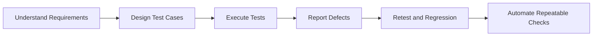

<h1 align="center">Fahim Faisal Talha</h1>

  <b>SQA Engineer</b> &nbsp;|&nbsp; Manual & API Testing &nbsp;|&nbsp; Test Automation &nbsp;|&nbsp; Laravel / PHP Developer

  
  
  

---

## About Me

I'm a **Software Quality Assurance engineer** with a strong **web development background**. I design test cases, validate APIs, report defects clearly, and automate repeatable checks. Because I also build applications in **Laravel and PHP**, I understand how software is made, which helps me find issues earlier and write more useful bug reports.

- 🧪 Focused on **SQA, API testing, and test automation**
- 🛠️ Experienced with **Laravel, MySQL, Vue.js, and Inertia.js**
- 🎓 B.Sc. in Computer Science & Engineering, **Daffodil International University** (CGPA 3.80)
- 📄 Research accepted at **IEEE WIECON-ECE 2025**
- 📫 Open to **SQA / QA Engineer** opportunities: **talhafahimfaisal@gmail.com**

---

## What I Do

| Area | Details |
|---|---|
| **Manual Testing** | Test case design, functional and non-functional testing, regression, smoke, sanity, UI, UAT, exploratory testing, BVA, equivalence partitioning |
| **API Testing** | Postman collections covering GET, POST, PATCH and DELETE, with positive, negative and boundary scenarios |
| **Automation** | Playwright and Selenium for UI test automation |
| **Defect Management** | Clear bug reports with severity, priority, reproduction steps, and expected vs. actual results |
| **Development** | Laravel, PHP, MySQL, Vue.js, Inertia.js, Tailwind CSS, Bootstrap |

---

## My Testing Workflow

<b>How I write a bug report</b>

 

| Field | What I include |
|---|---|
| **Title** | Short, specific summary of the problem |
| **Environment** | Browser, device, OS, build or version |
| **Severity / Priority** | Impact on the system vs. urgency to fix |
| **Steps to Reproduce** | Numbered, minimal and repeatable |
| **Expected Result** | What should happen according to the requirement |
| **Actual Result** | What really happens |
| **Evidence** | Screenshot, screen recording, logs, or API response |

---

## Tech Stack

**Testing & QA**

**Languages, Web, Databases & Tools**

  

**AI Tools:** OpenAI · Gemini · Claude Code · Codex · Open Code

---

## Experience

**System Engineer (QC) Intern** · Crystal Future Venture Ltd · *Jul 2026 – Sep 2026*
- Prepared QC reports, identified quality issues, and coordinated with field teams for rectification and resubmission
- Verified pre- and post-installation site photos against Grameenphone quality standards
- Inspected telecom site documentation and installation evidence for accuracy

---

## Currently Growing

- 🎯 Building stronger **Playwright** automation suites
- 📚 Preparing for **ISTQB Foundation Level**
- ⚙️ Learning **CI/CD basics** to run automated tests in pipelines

---

## GitHub Stats

  
  

---

  <i>Quality is not an act, it is a habit. Let's build reliable software together.</i>

